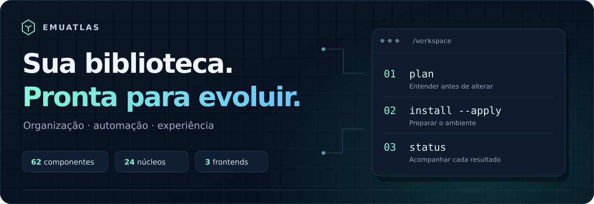
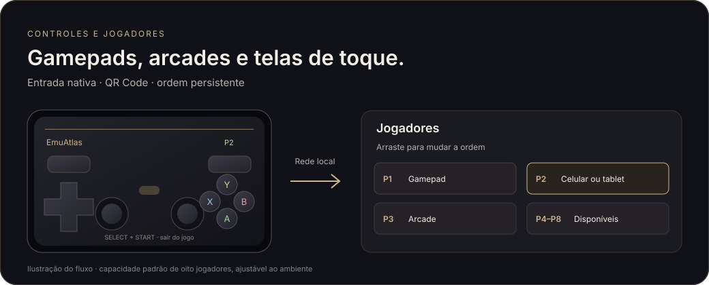
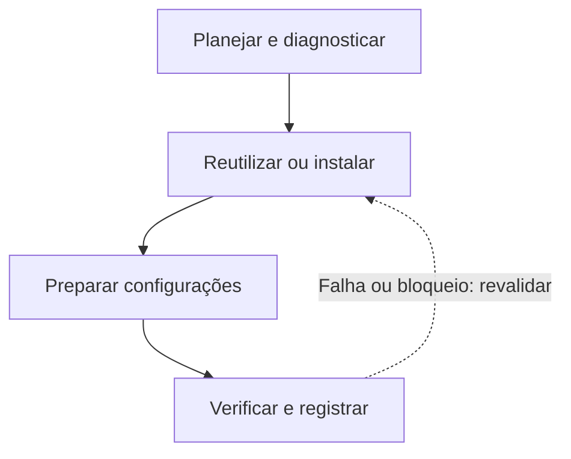

<div align="center">



# EmuAtlas

**Um lugar para organizar a biblioteca, preparar o host e conectar a experiência.**

<p>
  
  
  
  
</p>

<p>
  <a href="#instalar">Começar</a> &nbsp;·&nbsp;
  <a href="#ecossistema">Ecossistema</a> &nbsp;·&nbsp;
  <a href="#controles-e-jogadores">Controles e jogadores</a> &nbsp;·&nbsp;
  <a href="#sua-jornada-nos-jogos">Saves e jornada</a> &nbsp;·&nbsp;
  <a href="#estrutura">Estrutura</a> &nbsp;·&nbsp;
  <a href="#estado-do-projeto">Estado do projeto</a> &nbsp;·&nbsp;
  <a href="#guias">Documentação</a>
</p>

</div>

---

Bibliotecas de emulação crescem. Jogos, artes, versões, ferramentas e configurações precisam continuar fáceis de encontrar e manter. O **EmuAtlas** reúne esse trabalho em uma estrutura única, com instalação automatizada, organização por função e resultados verificáveis.

| 🧩 Um ecossistema | 🗂️ Uma organização | 🔎 Um histórico |
| :--- | :--- | :--- |
| Frontends, emuladores, núcleos e ferramentas conectados por receitas. | ROMs, mídias, BIOS, saves e configurações com destinos definidos. | Planos, hashes, logs e resultados por componente. |

O projeto também prepara a entrada nativa de teclado e gamepads, a atribuição de jogadores e os controles virtuais pelo navegador do celular ou tablet. Steam permanece uma integração opcional.

## Controles e jogadores



| Quero usar… | Como funciona |
| :--- | :--- |
| **Teclado ou gamepad** | Entrada nativa e painel de controles integrado à sessão. |
| **Um controle específico** | Representações de GameSir, 8BitDo, Xbox, PlayStation, Logitech e Switch. **Modelo** permite corrigir a identificação visual. |
| **Um arcade de luta** | Ilustrações de 8BitDo Arcade Stick, HORI Fighting Stick Alpha e Razer Kitsune. |
| **Um modelo desconhecido** | O arquivo canônico `default.png` fornece a representação padrão. |
| **Outra ordem de jogadores** | Arraste o controle até o jogador desejado. Posições ocupadas trocam os dois controles. A ordem fica salva. |
| **Celular ou tablet** | Abra **Controles → ＋ Adicionar celular ou tablet**, escaneie o QR Code na mesma rede local e toque em **Conectar controle**. Escolha o jogador na página ou no painel do host. |

### Controle móvel

A página responsiva oferece direcional, dois analógicos, A/B/X/Y, ombros, gatilhos, Select, Start e L3/R3. Cada navegador é um controle independente. O padrão é **oito controles móveis e oito posições de jogador**, com capacidade ajustável para a próxima sessão em `frontend/RetroFE/Config/controller-artwork.json`, no campo `player_capacity`. A quantidade efetiva de jogadores acompanha o suporte do jogo e do emulador.

O telefone continua conectado durante a passagem do frontend para o jogo. O comando **Select + Start por dois segundos** solicita a saída normal da janela do jogo. A legenda persistente e o botão **Controles** mantêm essas ações acessíveis. O serviço começa ao adicionar um controle e encerra com suas sessões consumidoras. Convites expiram em dois minutos. Uma nova sessão do host exige novo pareamento móvel. Perda de conexão por 750 ms libera os comandos e exige soltura antes de retomar.

O backend de dispositivos virtuais desta entrega usa **Linux/KDE e evdev/uinput**. A página pode ser aberta em navegadores móveis atuais, em retrato ou paisagem. O roteamento HTTP até oito portas virtuais foi ensaiado localmente, incluindo neutralização após falha de rede. A aceitação com oito telefones/tablets físicos, a latência da rede Wi-Fi e o backend de entrada nativo Windows permanecem pendentes.

As ilustrações de controles pertencem ao acervo canônico da instalação. A exportação pública contém o código, o mapeamento e a ilustração documental desta seção. As dependências do host incluem `qrencode`, evdev e Pillow, preparados pelo fluxo de instalação existente.

> [!IMPORTANT]
> **Prévia de engenharia.** A automação está implementada; a instalação integral em máquina limpa e a aceitação física de gameplay/controles ainda precisam de validação. As permissões de distribuição de cada componente seguem em revisão.

## Sua jornada nos jogos

O **RetroArch** recebe um histórico visual por jogo e core. Cada gravação observada conserva a versão nativa e reúne screenshot, número, data, horário, tempo observado e vínculos com o momento anterior.

| Durante o jogo | Sua jornada |
| --- | --- |
| **Cartão discreto à esquerda** | Um favorito fica em destaque. Passe o mouse para abrir cinco gravações e role pelas demais. |
| **♥ Favoritos** | Fixe momentos especiais. Favoritos vêm primeiro e cada grupo segue do mais recente ao mais antigo. |
| **♛ Chefe · ⚑ Final · ◆ Hiperdesafio** | Acrescente fases numeradas, outras marcações e uma nota pessoal. |
| **Retomada visual** | A imagem se centraliza, o momento corrente recebe uma cópia de segurança e a sessão continua após confirmação do emulador. |
| **Planilha da jornada** | Exporte CSV com tempos, hashes, imagens, notas e relações entre saves. |

Abra com **Select + Y no P1** ou **Ctrl + Shift + J**. Use ↑↓, **A** para retomar, **X** para favoritar, **Start** para marcações e **B** para voltar. Os dois atalhos aparecem na legenda persistente durante o jogo. Os nomes dos botões seguem o mapeamento lógico SDL. Mouse e teclado também operam a lista.

O histórico fica junto aos dados compartilhados do RetroArch em `emulator/data/RetroArch/states/journey/`. SQLite registra os metadados e PNG reúne imagem e dados imutáveis da captura. A versão nativa é preservada. Saves internos aparecem quando o core os grava em disco. O tempo é medido desde o monitoramento. Cores com suporte a states oferecem retomada visual dos saves de bateria por state acompanhante.

A interface desta entrega usa **Linux/KDE**. O ensaio isolado com RetroArch real verifica gravação, thumbnail e restauração do momento original. Aceitação física de gameplay, foco/composição e execução Windows continuam na matriz de validação. Consulte o contrato técnico e os controles completos. [Jornada de saves](tools/roms/docs/save-journey.md)

## Instalar

**Esta prévia inclui as fontes de engenharia, os templates e a documentação.** A seleção publicada exclui jogos, BIOS, saves e executáveis de terceiros. Os comandos a seguir destinam-se à instalação em **Linux x86_64**:

```bash
# 1. Conheça o plano — sem alterar o host
./install.sh plan

# 2. Instale os componentes e prepare as configurações
./install.sh install --apply

# 3. Consulte os resultados
./install.sh status
```

**Já existe algo instalado?** O fluxo procura componentes disponíveis, reutiliza downloads íntegros e preserva personalizações. Para retomar após uma falha, execute novamente o comando de instalação; o estado real é revalidado.

As dependências Python recebem um cache verificado por versão e host. Atualizações de fontes e templates têm preparação separada, conferência das personalizações e reversão pelo histórico. O guia de releases apresenta esse fluxo. [Atualização e reversão](docs/business/releasing.md)

Pacotes nativos podem exigir autenticação pelo **Polkit/sudo**. A inicialização não abre jogos ou interfaces dos emuladores. Em bibliotecas existentes, revise o plano antes de aplicar.

<details>
<summary><strong>Instalar um componente ou reduzir o paralelismo</strong></summary>

```bash
# Seleciona ES-DE e suas dependências declaradas
./install.sh install --components es-de --apply

# Usa um job nas compilações
./install.sh install --jobs 1 --apply
```

Um escopo parcial concluído aparece como `selected_scope_complete`. O campo `all_components_installed` só é verdadeiro quando o grafo completo termina sem falhas ou bloqueios.

Leia o [guia de instalação automatizada](docs/business/automated-install.md) para hosts suportados, retomada e limites.

</details>

## Ecossistema

<table>
  <tr>
    <td align="center"><strong>64</strong><br/>componentes no fluxo de instalação</td>
    <td align="center"><strong>24</strong><br/>núcleos libretro com receitas</td>
    <td align="center"><strong>4</strong><br/>frontends integrados ao instalador</td>
  </tr>
</table>

| Camada | O que o projeto prepara |
| :--- | :--- |
| **Frontends** | RetroFE, ES-DE, Pegasus e Quiver Launcher. O [Pegasus portátil](frontend/pegasus-frontend/README.md) compartilha os perfis de execução e a mídia canônica. |
| **Launcher alternativo** | [RocketLauncher](docs/business/architecture.md), adicionado localmente para lançamento de jogos pelos frontends; ativação no Linux pendente de validação. |
| **Emulação** | RetroArch, MAME, Dolphin, DuckStation, PCSX2, RPCS3, PPSSPP, Flycast, Cemu, melonDS, Azahar, xemu e Supermodel para Sega Model 3. |
| **Host** | Dependências de mídia, arquivos compactados, fontes, janelas, Python, Wine e ferramentas de compilação. |
| **Organização** | Inventário, integridade, identificação, variantes, compactação e planos reversíveis. |
| **Mídia** | Ferramentas de scraping/ingestão, metadados, histórias e caminhos compartilhados por plataforma. |
| **Compilações** | Receitas para RetroFE, ZArchive, orbis-unpkg e Eden-NX2. |
| **Pesquisa** | Eden-NX2, Eglantine, Xenia Canary Linux, KytyPS5, PS5PCEM e SharpEmu permanecem experimentais. |

As receitas usam pacotes do sistema, Flatpak, arquivos verificados ou fontes fixadas por commit. **Instalar um runtime não comprova compatibilidade jogável.**

### Um fluxo que permite retomar



Tarefas independentes podem continuar quando um componente falha. Dependências pendentes ficam explícitas; o instalador retorna código **2** enquanto a seleção tiver falhas ou bloqueios. Builds têm limite de jobs e tempo; as pesadas exigem o controle de recursos declarado.

## Estrutura

```text
workspace/
├── install.sh              # Entrada única da instalação
├── tools/
│   ├── distribution/       # Bootstrap, receitas, templates e releases
│   └── roms/               # Organizadores, validação e manutenção
├── frontend/               # Frontends e alternativa RocketLauncher
├── emulator/
│   ├── linux/              # Binários e núcleos Linux
│   ├── windows/            # Binários e núcleos Windows
│   └── data/               # Dados únicos compartilhados de emulação
├── roms/<system_id>/        # Biblioteca fornecida pelo usuário
├── media/<system_id>/       # Capas, vídeos, screenshots, histórias…
├── bios/                   # BIOS e firmware fornecidos pelo usuário
├── saves/                  # Saves e estados
├── metadata/               # Identidade e metadados locais
├── work/installation/      # Fontes, builds e cache verificado
├── outputs/installation/   # Planos, logs e resultados do instalador
└── docs/business/          # Arquitetura, operação e proposta do produto
```

**Código no repositório. Dados na instalação.** O pacote contém ferramentas, templates e documentação. Jogos, BIOS, chaves, saves, biblioteca pessoal de arte e executáveis de terceiros ficam fora; as aquisições previstas ocorrem na origem.

A mídia compartilhada possui uma origem canônica. Aliases relativos oferecem compatibilidade entre consumidores, evitando criar uma biblioteca de payloads para cada frontend.

Os emuladores usam a [estrutura portátil em emulator/](emulator/README.md), com binários separados por SO e dados compartilhados. O Linux atual foi preservado; os pacotes Windows estão preparados para aceitação nativa. Runtimes com pastas fixas exigem NTFS e preparação dos vínculos após mudar de unidade. A execução física no Windows e os binários Windows dos frontends ainda estão pendentes.

## Estado do projeto

| Implementado | Validação que permanece necessária |
| :--- | :--- |
| Instalador, dependências e retomada por componente. | Instalação integral em máquina limpa por distribuição. |
| Configuração vazia, repetição, mídia e realocação. | Jornada visual, gameplay e controles físicos. |
| Preservação de configurações e registro de alterações. | Aceitação dos cenários de falha e retorno ao desktop por host. |
| Receitas e aquisição de componentes externos. | Licenças e insumos da oferta comercial por componente. |

**Snapshot local de validação — 02/11/2026:**

- **26** testes da distribuição e **296** regressões das ferramentas passaram.
- **10/10** verificações automáticas do RetroFE passaram.
- ZArchive foi compilado e passou por compactação/extração com hashes idênticos.
- KytyPS5, PS5PCEM e Skraper foram instalados em pastas isoladas; ferramentas Python foram instaladas e importadas em venv privado.
- O pacote extraído passou pelo preflight de mídia, contrato de Opções/saída e realocação para pasta com espaços.

Esses resultados são verificações locais registradas, **não um badge de CI remoto nem uma homologação de todos os jogos**. Veja a [matriz de qualidade e evolução](docs/business/quality-and-roadmap.md).

<details>
<summary><strong>O que depende do usuário e do host?</strong></summary>

BIOS, firmware, chaves, jogos, login Steam, contas de mídia e decisões dos assistentes upstream continuam com o usuário. Hosts imutáveis não são desbloqueados automaticamente.

O RetroFE novo recebe um fallback textual próprio. **Aeon Nox e a biblioteca pessoal de artes não acompanham o pacote.** Temas e mídias adicionais exigem origem e permissões adequadas.

As dependências estão mapeadas para Arch/BigLinux, Debian/Ubuntu e Fedora. Os pacotes disponíveis e seus requisitos podem variar; a matriz de aceitação registra os limites da prévia.

</details>

## Guias

| Quero… | Abrir |
| :--- | :--- |
| **Instalar e retomar** | [Instalação automatizada](docs/business/automated-install.md) |
| **Entender os diretórios e caminhos** | [Arquitetura](docs/business/architecture.md) |
| **Trabalhar com fontes e mídias** | [Operação e aquisição](docs/business/operations.md) |
| **Preparar a oferta do produto** | [Filosofia e modelo de negócio](docs/business/README.md) |
| **Avaliar distribuição e proveniência** | [Política de distribuição](docs/business/distribution-policy.md) |
| **Acompanhar os critérios de entrega** | [Qualidade e evolução](docs/business/quality-and-roadmap.md) |
| **Gerar e publicar um pacote** | [Releases e repositório](docs/business/releasing.md) |

## Desenvolver

Nas fontes de engenharia, quando disponibilizadas:

```bash
python3 -m unittest discover -s tools/distribution/tests
python3 tools/distribution/release.py plan
```

A allowlist `tools/distribution/config/release-files.json`, presente nas fontes de engenharia, define os arquivos publicáveis. Alterações de conteúdo seguem **inventário → validação → plano → aplicação → verificação**; a reversão depende do manifesto da operação. Não há limpeza automática da biblioteca ao iniciar o frontend.

Para relatar um problema, reúna versão do pacote, host, componente, erro e passos de reprodução. Revise os logs antes de compartilhá-los; conteúdos pessoais não são necessários para reportar um defeito do instalador.

---

<div align="center">
  <strong>Organizar com critério. Automatizar com evidência. Evoluir com consistência.</strong><br/>
  <sub>EmuAtlas · organização e automação para emulação</sub>
</div>
